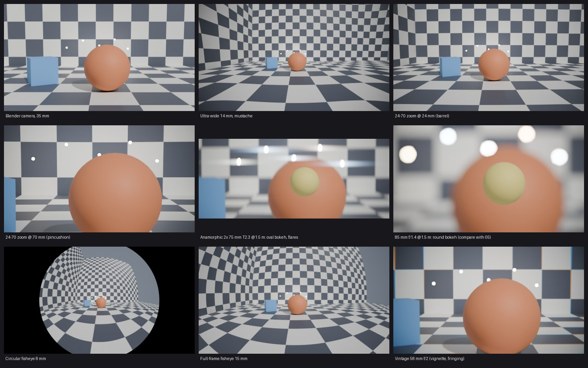

# Lensder — real camera bodies and lenses for Blender

Lensder makes a Blender camera behave like a real camera body with a real lens:
radial distortion (barrel, pincushion, mustache), **anamorphic** squeeze and
distortion with oval bokeh and streak flares, **fisheye** projections, focus
breathing, vignetting, colour fringing, plus the photographer's controls
(aperture, shutter, ISO, white balance).



*All images: same scene, ray-traced in Cycles through Lensder presets
(regenerate with `scripts/render_samples.py`).*

- **Blender 5.0+**, tested on **5.2.2 LTS**.
- Exact, ray-traced lenses in **Cycles**, or a post-process path for **EEVEE**
  and any GPU.
- Files render on farms **without the add-on installed**. The shader and every
  value it needs are stored in the `.blend`, and this is covered by tests.

---

## Install

1. Get `lensder-<version>.zip`: download the **lensder-extension** artifact
   from the latest *tests* run on GitHub Actions, or build it yourself (see
   *Building* below).
2. Blender ▸ *Edit* ▸ *Preferences* ▸ *Get Extensions* ▸ ⌄ ▸ *Install from Disk…*
   and pick the zip.

## Quick start

1. Select a camera. In the 3D Viewport press **N** and open the **Lensder** tab.
   The same panel is also under *Properties* ▸ *Camera*.
2. Switch the mode from **Blender** to **Camera Kit**.
3. Pick a **Camera Body** (e.g. *Full Frame*, *ARRI ALEXA 35*) and a **Lens**
   (e.g. *Standard Zoom 24–70mm*, *Anamorphic 2× 40mm*, *Circular Fisheye 8mm*).
4. Set the **focal length** (zoom), **aperture** and **focus**, just like on a real
   camera. Zooms can't go past their range, and a lens can't open wider than its
   maximum aperture.
5. Click **Preview in Viewport**. With Cycles you see the real lens in Rendered
   mode. With EEVEE the viewport compositor shows it. In any mode an orange
   **lens grid** shows how straight lines bend.

## The three modes

| Mode | For | What you control |
|---|---|---|
| **Blender** | The standard camera | Nothing: Lensder is off and the camera is untouched |
| **Camera Kit** | Everyone | Body, lens preset, focal length, aperture, focus, plus *Distortion / Vignetting / Breathing* amounts (0–200 % of the lens' character) |
| **Advanced** | Matchmove / VFX / tinkering | The full lens model: Brown–Conrady k1–k4, p1, p2; Division; Nuke; 3DE4 Radial Std deg 4; 3DE4 Anamorphic deg 4/6 (Cx02…Cy66, rotation, squeeze); fisheye projection + Kannala–Brandt k1–k4; distortion centre; vignetting polynomial; breathing |

Switching **Camera Kit → Advanced** keeps the current look: the preset's
effective coefficients are copied over for you to edit. **Copy Lens from Movie
Clip** imports a lens that Blender's Motion Tracker solved, so CG matches your
footage.

## Camera controls ↔ what Blender does

| Real camera | Lensder | Blender underneath |
|---|---|---|
| Sensor / recording format | Camera Body | Sensor size and fit (the frame is cropped to your render aspect) |
| Anamorphic squeeze | from the lens (Advanced: editable) | Desqueezed sensor width; `aperture_ratio` = squeeze gives vertically oval bokeh |
| Zoom / focal length | Focal Length (limited to the lens' range) | `Camera.lens` (driven by Lensder) |
| Aperture (f/T-stop) | Aperture f/ | `dof.aperture_fstop`; blades from the lens |
| Focus | Focus On / Focus Distance | `dof.focus_*`; also drives **focus breathing** |
| Shutter speed / angle | Shutter & Motion Blur | `render.motion_blur_shutter` = time × fps, or angle / 360 |
| ISO + exposure triangle | Exposure: *Auto* or *Manual* | `view_settings.exposure` in stops, relative to a metered reference |
| White balance (K, tint) | White Balance | `view_settings.white_balance_*` (3200 K turns a daylight scene blue, as on a camera) |

**Auto vs Manual exposure.** In *Auto* (the default), changing the aperture
only changes depth of field, and brightness stays the same. In *Manual*,
stopping down one stop darkens the image by one stop, exactly like a real
camera. Press **Meter Here** to tell Lensder which settings give "correct"
exposure. Lensder deliberately does not attempt absolute photometric
exposure; Blender's light units make that scene-dependent.

## Two ways to render the lens

| | **Ray-traced** (default with Cycles) | **Post-process** (EEVEE, CUDA, HIP, Metal…) |
|---|---|---|
| How | A Cycles **custom OSL camera** traces each pixel's ray through the lens model | The scene is rendered with a wider pinhole view (overscan), then the **compositor** remaps it with an ST-map |
| Quality | Exact, no resolution loss, correct with depth of field | Slight softening where barrel distortion magnifies the edges; wide fisheyes lose resolution |
| Works with | Cycles on **CPU or NVIDIA OptiX** | Any engine and device |
| Viewport | Rendered shading, camera view | Viewport compositor (camera view) |

*Distortion Method ▸ Automatic* picks for you. Chromatic aberration and streak
flares are always compositor effects, and both are noise-free. They are
**opt-in**, because they add a node to your compositor. Lensder inserts its
node just before the output and never rewires your own nodes.

**Export ST-Map** writes the distortion as OpenEXR for Nuke, Fusion or After
Effects.

## Limitations (honest list)

- Blender cannot bend Solid-mode geometry. In Solid mode you see the lens
  **grid overlay**, not a distorted image.
- In post-process mode the camera frame is enlarged by the overscan factor
  (shown in the panel). The white overlay rectangle marks the real frame.
- Scene-level controls (exposure, white balance, shutter) follow the
  **active scene camera** and are applied when you change them, not per frame.
  Keyframing the aperture with *Manual* exposure therefore does not ramp
  brightness during an animation render. To animate exposure, keyframe Blender's
  own *Exposure* with Lensder's exposure control off.
- Focal length and f-stop are owned by Lensder while it is active. Existing
  keyframes on Blender's own *Focal Length* are overridden; the panel warns
  you, so animate Lensder's instead.
- Not modelled in v1: anamorphic *mumps* (squeeze changing with focus),
  per-axis breathing, rolling shutter, ISO noise.
- 3DE4 coefficients use AliceVision's normalisation. They should be close to
  3DEqualizer's output but are not guaranteed bit-identical
  (see [docs/research.md](docs/research.md)).
- **Not verified in this environment** (no GPU here):
  - drawing of the viewport overlay
  - the viewport compositor
  - OptiX rendering

  Everything else is covered by automated tests in Blender 5.2.2.

## How it was designed

Read [docs/research.md](docs/research.md) for the lens models (with sources),
what Blender 5.2 can and cannot do (each point verified headlessly), and the
design decisions that followed. Architecture notes and the debugging log are
in [development_note/](development_note/index.yaml).

## Building and testing

```bash
python -m venv .venv && . .venv/bin/activate
pip install bpy==5.2.2 numpy pytest pillow       # Blender as a Python module (Python 3.13)

python -m pytest tests                            # 114 tests: maths + headless Blender (Cycles CPU)

# build the installable extension zip with Blender's own tool
python .venv/lib/python3.13/site-packages/bpy/5.2/scripts/addons_core/bl_pkg/cli/blender_ext.py \
    build --source-dir lensder --output-dir dist

python scripts/render_samples.py samples          # regenerate the sample images
```

The tests check, among other things:
- The generated OSL camera matches the NumPy reference per pixel to < 0.03°, for
  every model.
- The post-process path matches the same geometry to < 0.25 px, including inside
  an animation render.
- A saved file renders correctly with the add-on uninstalled.
- Every UI panel only references properties and operators that exist.
- No dependency cycles occur.

## Layout

```
lensder/            the extension (blender_manifest.toml)
  core/             pure maths, no bpy: lens models, presets, ST-maps, OSL generator
  props.py idprops.py sync.py backend_osl.py backend_comp.py overlay.py ui.py ops.py handlers.py
tests/              pytest; tests/blender/ runs inside Blender
docs/research.md    research notes and sources
scripts/            sample renders
```

## License

GPL-3.0-or-later (see `LICENSE`), as required for Blender add-ons. Preset
magnitudes were calibrated against the lensfun database (CC-BY-SA 3.0); no
lensfun data is redistributed.
